# Music discovery and collections

The new external-playlist import workflow is described in [Usage](USAGE.md#import-netease-and-qq-playlists) and the [Mac companion guide](tools/playlist_import/README.md). It supports NetEase and QQ sharing links, stores imported playlists and pending audio requests on the music server, and updates only when the user asks. Missing audio is downloaded in the official desktop client, validated locally and passed to the existing upload pipeline. Physical-phone hub playback, event upload and reconnect retry are verified below. Actual new-audio download and upload still require the NetEase desktop client and login; synthetic and existing-library fixtures do not replace that validation.

## Confirmed scope

Make a large personal server library easier to explore using both library-based discovery and genuine external charts. Provide named collections with selectable icons, saved as server playlists for other devices. Selecting a song keeps the list and mini player visible; a deliberate mini-player tap opens the full player. Existing heart favorites, playlists, radio stations and podcast subscriptions remain available.

## Product references and choices

Reviewed on 2026-10-25:

| Reference | Observed pattern | Tempus implementation |
| --- | --- | --- |
| [Spotify: Find playlists](https://support.spotify.com/us/article/find-playlists/) | Discovery groups and listening-based playlists provide starting points | Unheard exploration, random roaming, server play history and genres provide concrete entry points into the user’s own library |
| [Spotify: Create playlists](https://support.spotify.com/us/article/create-playlists/) | Named playlists let users organize listening around situations | Reuse standard server playlists as collections, with a visible name and selectable icon |
| [NetEase official charts](https://music.163.com/discover/toplist?id=3778678) | Separate hot, new and rising charts, ranked track lists | Six clearly selectable chart sources, rank, cover, artist and library availability per row |
| [Apple Music web guide](https://support.apple.com/zh-cn/guide/music-web/welcome/web) and its public chart feed | Library, discovery and playlist navigation share familiar music objects | Reuse existing track/album actions and server playback; keep a stable mini player while browsing |

The discovery page is an additional browsing route into existing music objects. It does not generate fake popularity numbers, replace heart favorites, require lyrics, or create a second local collection system.

## Library discovery

- **Unheard exploration:** up to 40 songs from one or two random server batches of 300. Excludes known positive server play counts, local chronology entries for the active server, duplicate IDs and recently shown IDs in the current discovery session. Unknown play counts use the available local history. This cannot prove that a song was never heard on another device when the server does not provide those records.
- **Random roaming:** up to 40 songs, shuffled from a random server batch.
- **Recently added / Most played:** up to 50 server albums, using `newest` and `frequent` ordering.
- **Genres:** server-provided tags; song pages of 100 with explicit load-more. Genre counts reflect the metadata supplied by the server.
- Random, album, genre-song and search requests use the active music folder. The heard-ID query is scoped to the active server. Loading is bounded and does not scan or download the entire library.
- Switching mode, chart source or server invalidates previous work. The three-worker executor limits matching concurrency; stale callbacks cannot replace a newer result.

## Chart sources and matching

| Source | Endpoint |
| --- | --- |
| NetEase Hot | `https://music.163.com/api/playlist/detail?id=3778678` |
| NetEase New | `https://music.163.com/api/playlist/detail?id=3779629` |
| NetEase Rising | `https://music.163.com/api/playlist/detail?id=19723756` |
| Apple Music mainland China | `https://rss.applemarketingtools.com/api/v2/cn/music/most-played/100/songs.json` |
| Apple Music Japan | `https://rss.applemarketingtools.com/api/v2/jp/music/most-played/100/songs.json` |
| Apple Music US | `https://rss.applemarketingtools.com/api/v2/us/music/most-played/100/songs.json` |

Each source displays at most 100 actual entries and the provider’s update timestamp. Chart JSON has an atomic six-hour cache, a 4 MiB response bound and a 30-second request limit. A valid older cache can be used after a network failure and is labelled as cached. The NetEase endpoint is public but not a guaranteed stable API; provider changes can require an update. A separate HTTP client carries no Subsonic authentication.

**Match my library** searches the active server for each chart title, up to 40 candidates per search. Automatic matches require an exact normalized title, a matching artist and, where both durations are known, no more than a 12-second duration difference. Unicode width/case and punctuation are normalized; version words such as Live and Remix remain significant. Different performers are not silently substituted. Multiple exact versions require user selection; other server search candidates can be reviewed explicitly. The play-all action only includes uniquely selected matches, deduplicated by server ID. No external chart audio is streamed or imported.

## Collections and server synchronization

A collection is an ordinary Subsonic playlist. The existing create, update, rename, delete and song-membership APIs perform all writes. An optional icon is encoded as a visible Unicode prefix plus a space in the playlist name, for example `🌙 Night listening`. Tempus shows a colored icon tile and the clean title in collection lists; other clients retain the readable icon and title without proprietary metadata. A collection can instead use normal album artwork.

The song menu opens the existing playlist chooser; a song can belong to multiple collections. Add waits for the server acknowledgement. With duplicate entries disabled in existing preferences, it fetches the current server playlist before adding and reports an already-present song. Failure keeps the chooser available for retry. The chooser preserves playlist visibility unless the public switch is explicitly changed. No Room schema migration is needed.

## Player behavior

The collapsed player body is hidden before the first frame and when collapsing. A settling collapse is no longer misread as an expanded player. Pending initialization callbacks re-check expansion before collapsing, and explicit expansion cancels pending callbacks. Explicit navigation from a player asset link still collapses the player. Regression tests exercise the timing and state boundaries.

## Validation

Both signed release flavors built successfully; Degoogled has 244 tests and Tempus has 250, with zero failures and one existing skipped test in each suite. Both debug lint tasks passed with the repository baseline and warnings. The physical PMX110 phone verified library discovery, 100-to-144 genre pagination, chart matching and playback, collection create/add/deduplicate/rename/icon changes, and restart/server re-fetch. Apple Music mainland China matched 23 unique playable tracks from 100 entries with zero request failures in this library. All six chart endpoints returned valid JSON in point-in-time desktop checks; provider availability can change. A second physical device was not used.

Full local logs, source health JSON and player recordings are retained in the ignored `dist/discovery-collections/` directory. These feature checks used version 1.0.0; the release commit changes only the version to 1.0.1. Repository screenshots below document the UI changes.

| Player before | Player after |
| --- | --- |
| 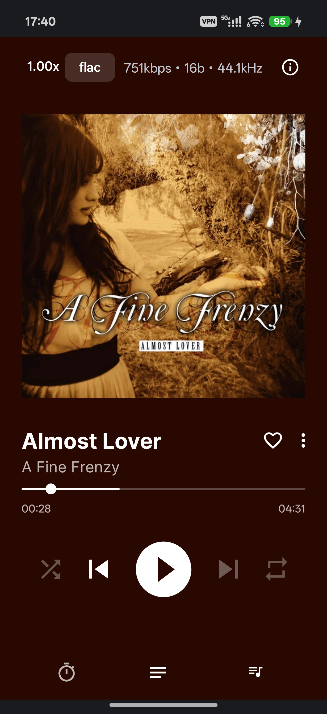 | 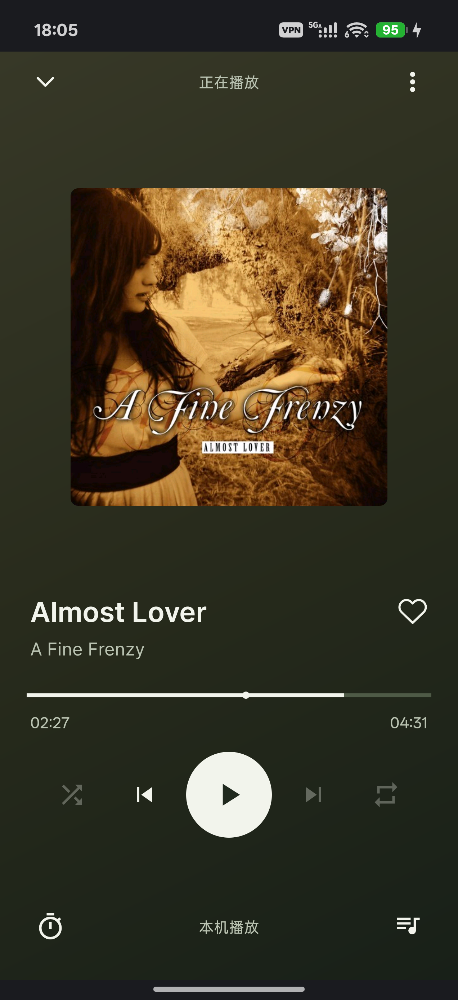 |

| Music discovery | Server-synced collection after restart |
| --- | --- |
| 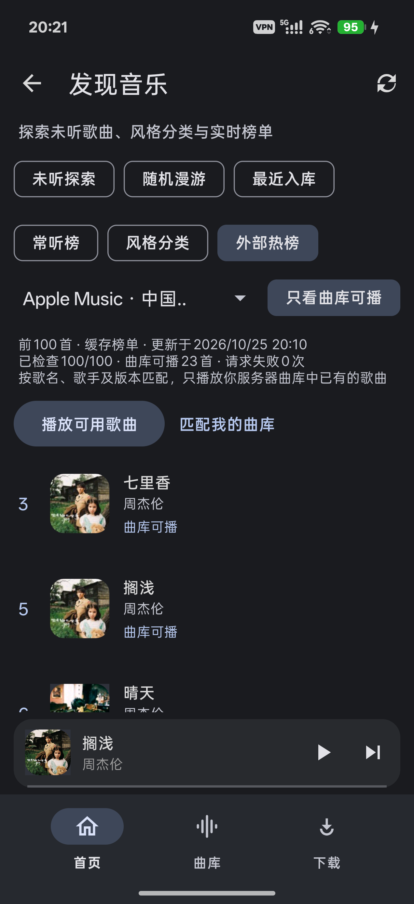 | 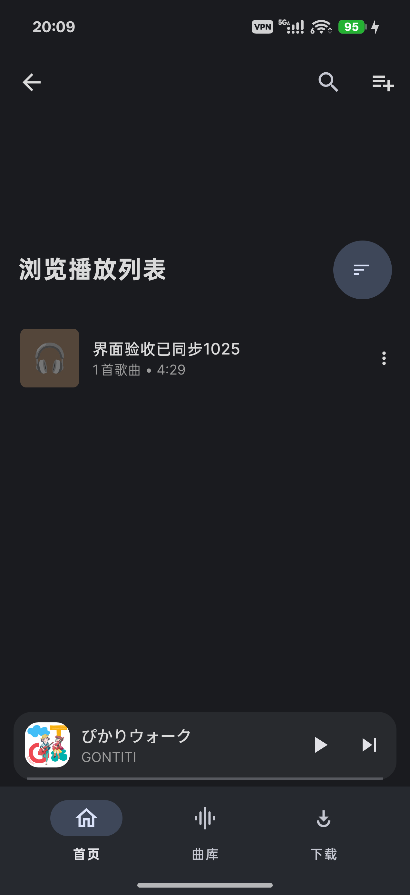 |

## Player and browsing refresh

The bottom navigation now provides Home, Discover, Search and Library. Home has quick links, a daily mix and personal radio. Discover groups library and external charts, language/decade/genre browsing and an A–Z artist index. Search shows genre tiles before a query; Downloads is available in Library. Language grouping uses artist-name scripts and can be imperfect. The portrait player uses cover-derived moving colours, three large transport controls and a separate queue with shuffle/repeat. Lyrics remain optional. This fork now requires Android 14 or later.

The cover-button overlay used an automatic `LayoutTransition` that also animated ancestor bounds. It competed with `BottomSheetBehavior`, causing the mini player to jump to the top when first shown or swiped down. The overlay now uses only its existing explicit fade. The sheet retains control of its position, including during manual expansion and collapse.

Both signed release flavors built after the fix. Degoogled ran 253 unit tests and Tempus ran 259, with zero failures/errors and one existing skipped test in each suite. Both debug lint tasks passed. A signed Degoogled release was installed over the existing app on the physical PMX110, preserving its server and library settings. Three recorded cycles of dismissing the mini player and starting another song showed no top jump or blank-page obstruction. Manual full-player expansion, downward collapse and artwork-overlay toggling also passed. The Tempus flavor was built and unit-tested but was not installed on a second physical device.

Local recordings and validation notes are retained in the ignored `dist/miniplayer-fix/` directory.

| Previous portrait player | Refreshed portrait player |
| --- | --- |
|  | 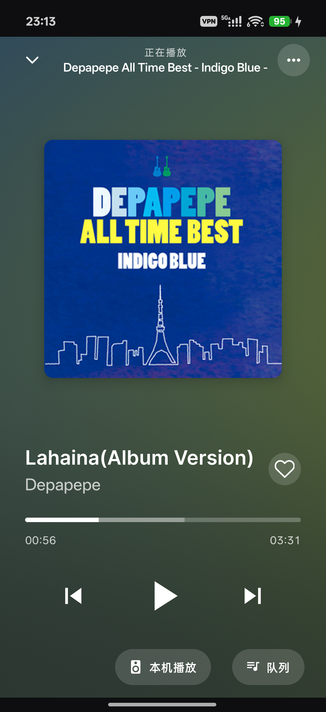 |

| Home shortcuts | Discover charts |
| --- | --- |
| 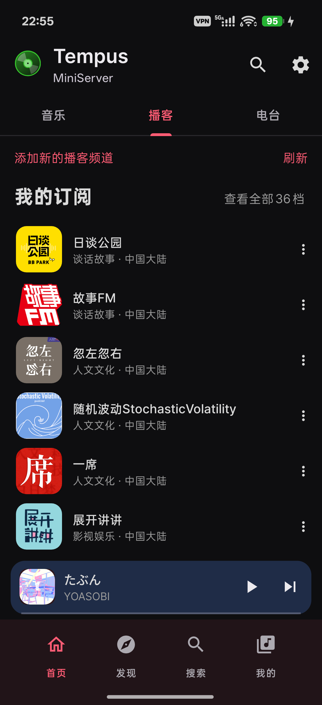 | 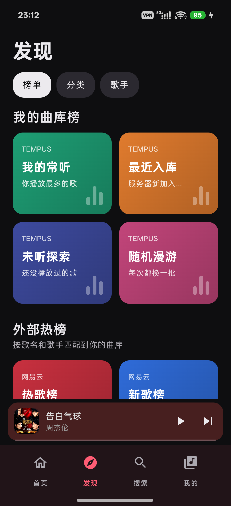 |

| Reproduced mini-player jump | Mini player after the fix |
| --- | --- |
| 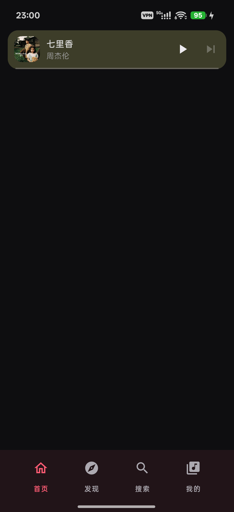 | 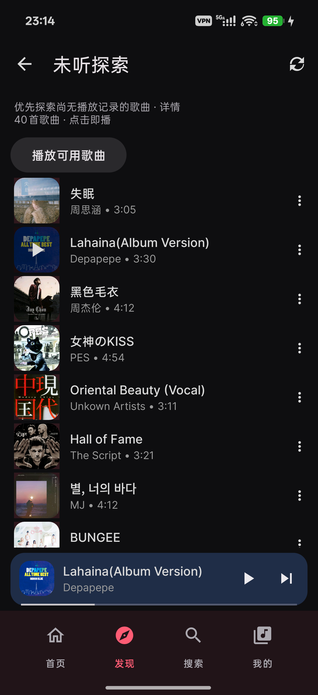 |

## Hub integration — October 28, 2026

The agreed first phase supports multiple Navidrome accounts and independent device profiles. The Android hub outbox records individual completed/skip events instead of deriving counts from the chronology table, whose primary key retains only the latest entry per song. Hub recommendations do not use account-level stars or play counts. The Rust source, migration, deployment, rollback and HTTP regression tests live in [services/tempus-hub](services/tempus-hub/README.md). The Mac helper supports account-scoped hub configuration and explicitly scoped legacy SSH reads. Existing external import and audio-validation work is reused.

Both signed release flavors built; Degoogled has 294 unit tests and Tempus has 300, with zero failures/errors and one existing skipped test in each suite. Both debug lint tasks passed. The physical PMX110 retained its existing login and library after the signed Degoogled update. A device outbox instrumentation test passed. Live checks verified 30 server recommendations, five pending tracks visible to the Mac helper, playback, skip and end-of-track events, and offline queuing followed by upload after reconnect. Wi-Fi and mobile data were restored to their prior enabled states.

The Linux release binary passed four HTTP integration tests against a local fake Navidrome; six Rust unit tests and 17 Mac helper tests passed locally. A controlled live Navidrome fixture verified ordered fill with duplicate positions, then removed its temporary playlist and hub records. The fixture used real library recordings with synthetic provider IDs, so it does not establish external-source or download correctness. The Mac has QQ Music but no NetEase desktop client/download directory; actual download → upload → new-file scan remains unverified. Multiple accounts/devices were tested with simulated accounts, not a second real user or physical device.

| Existing home recommendation | Server-generated device recommendation |
| --- | --- |
|  | 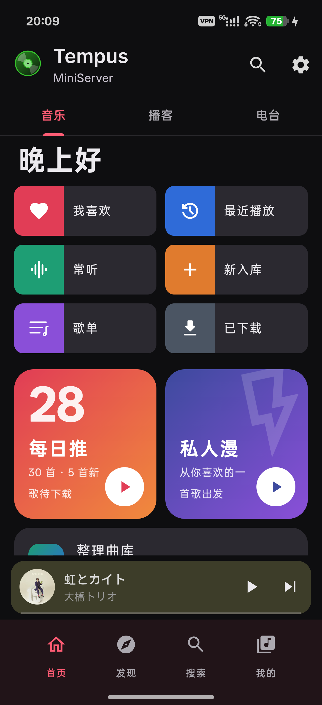 |

The signed app on PMX110 read all 200 NetEase Hot Chart entries and completed library matching: six unique matches, 194 missing, zero ambiguous rows. The read-only preview was checked on the physical phone without saving. The import page's dark-theme text contrast was corrected and verified on the phone.

| Import before contrast fix | Complete public-playlist preview after fix |
| --- | --- |
| 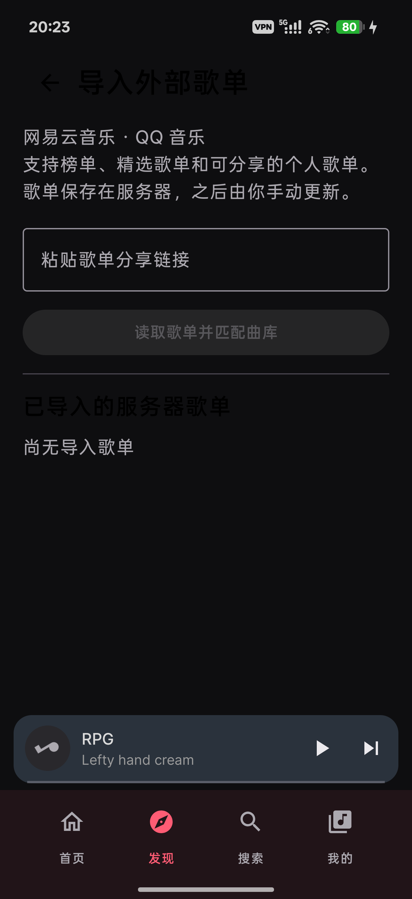 | 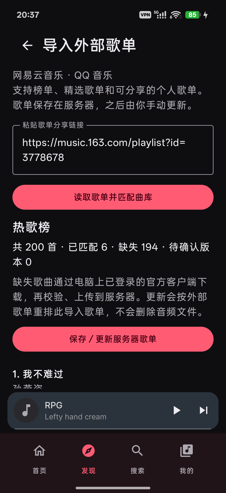 |
